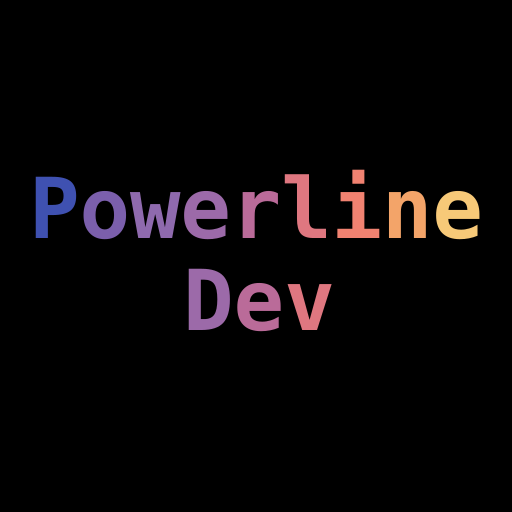

# Logo Guidelines

Powerline Dev uses a minimalist, typography-based visual identity.

Official logos combine bold monospace typography with the signature color palette.

## Organization Icon

| Property | Value |
|---|---|
| Layout | Two lines |
| Text | Powerline / Dev |
| Aspect ratio | 1:1 |
| Background | `#000000` |
| Primary format | SVG |
| Alternative format | PNG |

### Intended Usage

- GitHub organization avatar.
- Social media profile images.
- Organization-level icons.
- Compact brand placements.

## Organization Header

| Property | Value |
|---|---|
| Layout | Single line |
| Text | Powerline Dev |
| Background | Transparent |
| Primary format | SVG |

### Intended Usage

- GitHub README headers.
- Documentation.
- Websites.
- Organization-level presentations.

## Project Logos

Individual projects maintain their own logos and other visual assets within their respective repositories.

Project logos should:

- Follow the shared color palette.
- Use the standard monospace typography.
- Maintain a minimalist appearance.
- Clearly identify the project.
- Remain visually consistent with the organization.

## Usage Rules

- Preserve the original aspect ratio.
- Do not stretch or distort logos.
- Do not modify the signature color order.
- Do not introduce shadows, decorative effects, or unrelated symbols.
- Maintain sufficient spacing around the logo.
- Use transparent backgrounds for horizontal headers.
- Prefer SVG whenever supported.

## Related Guidelines

- [Color Palette](./colors.md)
- [Typography](./typography.md)
